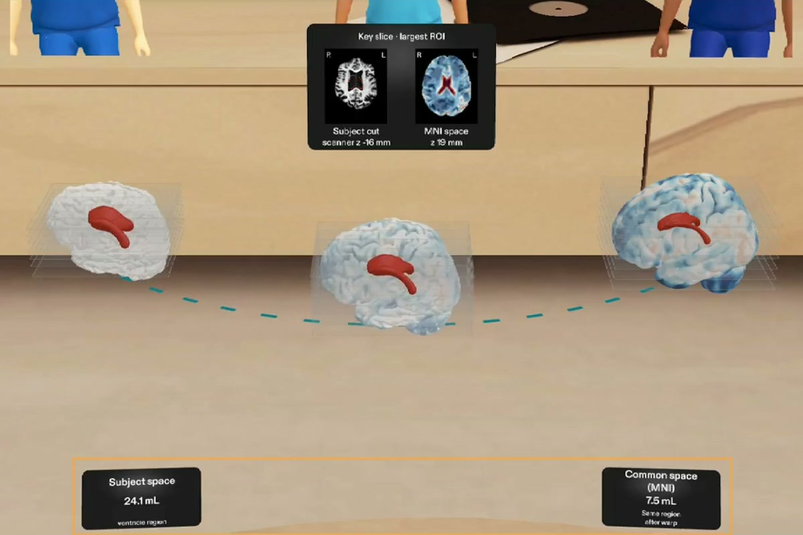

<p align="center"></p>

# Where Does the Atrophy Go?

**A neuroimaging tutorial and Spectacles Lens on why a brain region shrinks after registration, and how Jacobian weighting recovers its volume.**

[](https://youtu.be/C-fxrHdHAcM)

The same scan in two coordinate systems. Registration changes the image, not the patient's brain.

| Measurement | Volume | Source |
| --- | --- | --- |
| Region in subject space | **24.1 mL** | `pipeline/.results/tables/weighted-volume.json` → `volumes_ml.subject` |
| Same region resampled into common (MNI) space | **7.5 mL** | same file → `volumes_ml.mni` |
| Common space with Jacobian weighting | **23.6 mL** | same file → `volumes_ml.jacobian_weighted` |

## Quick start

```bash
micromamba env create -f pipeline/environment.yml
micromamba run -n ants-reg python pipeline/fetch_raw.py
export ATROPHY_ASSET_DIR="$PWD/pipeline/.results/rebuilt-lens/Brain"
micromamba run -n ants-reg python pipeline/run.py --resources
micromamba run -n ants-reg python pipeline/verify.py   # status: PASS
```

To open the Lens: `git lfs pull`, then open `lens.esproj` in Lens Studio 5.24.1 with a Spectacles profile and Interactive Preview.

The demo video is a Lens Studio Preview recording with scripted simulated-hand input at 2× speed; no Spectacles device use is claimed.

| Read more | |
|---|---|
| [Tutorial](docs/tutorial.md) | Requirements, the full rebuild, reading the numbers and recomputing the correction |
| [Method](docs/method.md) | Subject and common space, the pullback Jacobian, and what this example does not establish |
| [The Lens](docs/lens.md) | Opening the Lens, the interaction and the honest scope of the demo |
| [Source and credits](docs/sources.md) | Code map, tests, build records, data and third-party licences |

Project code is MIT licensed ([`LICENSE`](LICENSE)); third-party terms are in [`NOTICE`](NOTICE) and [`third-party-licenses/`](third-party-licenses/).
